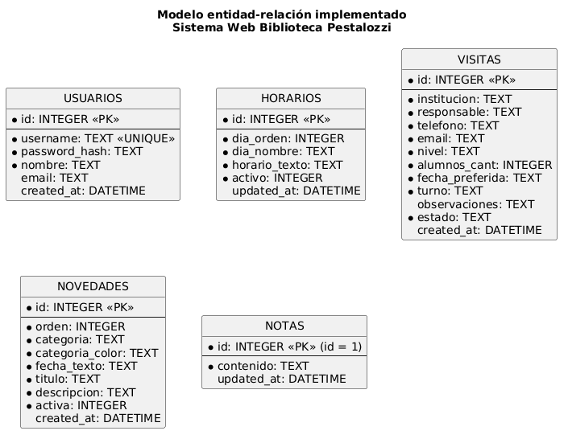

# Manual Técnico

**Sistema Web Institucional — Biblioteca Popular Pestalozzi**  
**Ciudad de Berisso, Buenos Aires**

| | |
|---|---|
| **Proyecto** | Proyecto Integrador — Práctica Profesionalizante IV |
| **Equipo** | Grupo Clouds: Eduardo Moreno, Leandro Paryszewski, Marcelo Moreno, Melissa Galeano Ibañez |
| **Versión del documento** | 1.0 — 07/11/2026 |
| **Repositorio** | https://github.com/hleopary/biblioteca-pestalozzi-web |

---

## 1. Introducción

### 1.1 Objetivo

Este manual describe cómo está construido el sistema, qué componentes lo integran y cómo instalarlo, ejecutarlo, mantenerlo y desplegarlo.

Está dirigido a personas con conocimientos de desarrollo que necesiten continuar el proyecto sin depender del equipo original.

### 1.2 Alcance

El sistema cubre tres frentes:

1. **Sitio público**: información institucional, colecciones, novedades, horarios de atención, catálogos externos, trámites, formulario de consulta y solicitud de visitas escolares.
2. **Panel de administración**: acceso autenticado para la bibliotecaria, con edición de la cartelera de horarios, publicación de novedades, gestión de solicitudes de visita y un bloc de notas.
3. **API REST**: capa de persistencia y lógica de negocio que consume el panel y, para los datos públicos, el propio sitio.

### 1.3 Fuera de alcance

- Catálogo bibliográfico propio: los catálogos Koha y Greenstone son sistemas externos y se enlazan, no se replican.
- Registro de usuarios públicos: el sitio no exige cuenta a los visitantes.
- Gestión de préstamos: el trámite se deriva a los canales institucionales.

---

## 2. Arquitectura del sistema

### 2.1 Modelo general

El sistema sigue una arquitectura **por capas**, con separación entre presentación, lógica de negocio y persistencia.

```
┌─────────────────────────────────────────────────────────────┐
│ Presentación                                                │
│  index.html · admin.html · css/ · js/ (vanilla, sin build)  │
└───────────────────────────┬─────────────────────────────────┘
                            │ fetch /api/...
┌───────────────────────────▼─────────────────────────────────┐
│ Lógica de negocio (Express)                                  │
│  routes → controllers → validators · middlewares             │
└───────────────────────────┬─────────────────────────────────┘
                            │ consultas SQL
┌───────────────────────────▼─────────────────────────────────┐
│ Persistencia                                                 │
│  SQLite (node:sqlite) · db/schema.sql · db/seed.sql          │
└─────────────────────────────────────────────────────────────┘
```

Decisiones relevantes:

- **Frontend sin build**: HTML, CSS y JavaScript nativo. No hay bundler ni framework, lo que simplifica el despliegue estático y el mantenimiento.
- **Backend propio**: Node.js + Express con SQLite embebido, sin servidor de base de datos separado.
- **Misma aplicación sirve sitio y API**: `backend/server.js` publica el sitio estático y expone `/api`, de modo que en producción todo comparte origen y no hace falta CORS.

Los fundamentos están registrados en los ADR del directorio `adr/`, en particular ADR-0010 (backend Node/Express) y ADR-0012 (reconciliación del DER).

### 2.2 Tecnologías

| Componente | Tecnología | Versión |
|---|---|---|
| Runtime | Node.js | 24 (Dockerfile `node:24-alpine`) |
| Framework HTTP | Express | ^4.21.1 |
| Base de datos | SQLite mediante `node:sqlite` | incluido en Node 22+ |
| Autenticación | jsonwebtoken | ^9.0.2 |
| Hash de contraseñas | bcryptjs | ^2.4.3 |
| Correo | nodemailer | ^6.9.15 |
| CORS | cors | ^2.8.5 |
| Variables de entorno | dotenv | ^16.4.5 |
| Pruebas | `node:test` nativo | Node 24 |
| Frontend | HTML5, CSS3, JavaScript ES6+ | sin build |

> `node:sqlite` es experimental en Node 24: al arrancar imprime un `ExperimentalWarning`. Es informativo y no afecta el funcionamiento.

---

## 3. Estructura del proyecto

```
biblioteca-pestalozzi-web/
├── index.html                 Sitio público
├── admin.html                 Panel de administración
├── css/
│   ├── styles.css             Estilos del sitio
│   └── admin.css              Estilos del panel
├── js/
│   ├── main.js                Lógica del sitio público
│   ├── api-client.js          Cliente HTTP de la API
│   └── admin.js               Lógica del panel
├── assets/img/                Imágenes en AVIF
├── backend/
│   ├── server.js              Punto de entrada: app, estáticos y arranque
│   ├── package.json           Dependencias y scripts
│   ├── .env.example           Variables de entorno documentadas
│   ├── test-api.js            Suite end-to-end histórica
│   ├── scripts/db.js          CLI de base de datos
│   ├── tests/
│   │   ├── validators.test.js Pruebas unitarias
│   │   └── api.test.js        Pruebas de integración
│   └── src/
│       ├── config/
│       │   ├── db.js          Conexión y aplicación del esquema
│       │   └── seeder.js      Seed y usuario administrador
│       ├── controllers/       Lógica de cada recurso
│       ├── middlewares/       Autenticación y manejo de errores
│       ├── routes/            Definición de endpoints
│       ├── services/          Envío de correo
│       └── utils/validators.js Validaciones puras
├── db/
│   ├── schema.sql             Esquema (fuente única)
│   └── seed.sql               Contenido inicial
├── docs/
│   ├── der/                   DER implementado (puml + png)
│   ├── evidencia/             Evidencia de pruebas y de base de datos
│   └── manual-tecnico.md      Este documento
├── adr/                       Decisiones de arquitectura
├── vercel.json                Configuración del sitio estático
└── .vercelignore
```

---

## 4. Base de datos

### 4.1 Motor y ubicación

SQLite embebido en el proceso de Node mediante `node:sqlite`. El archivo se ubica en `backend/data/pestalozzi.db` y su ruta se configura con `DB_PATH`.

El esquema versionado es `db/schema.sql` y es la **fuente única**: lo aplica `backend/src/config/db.js` al arrancar y también el comando `npm run db:migrate`. Todas las sentencias usan `CREATE TABLE IF NOT EXISTS`, por lo que son idempotentes.

### 4.2 Diagrama entidad-relación



El diagrama fuente está en `docs/der/der-implementado.puml`.

### 4.3 Tablas y campos

#### `usuarios`

| Campo | Tipo | Restricciones | Descripción |
|---|---|---|---|
| `id` | INTEGER | PK, AUTOINCREMENT | Identificador |
| `username` | TEXT | UNIQUE, NOT NULL | Usuario de acceso |
| `password_hash` | TEXT | NOT NULL | Hash bcrypt (10 rondas) |
| `nombre` | TEXT | NOT NULL | Nombre visible |
| `email` | TEXT | — | Correo de contacto |
| `created_at` | DATETIME | DEFAULT CURRENT_TIMESTAMP | Alta |

#### `horarios`

| Campo | Tipo | Restricciones | Descripción |
|---|---|---|---|
| `id` | INTEGER | PK, AUTOINCREMENT | Identificador |
| `dia_orden` | INTEGER | NOT NULL | 1 = lunes … 7 = domingo |
| `dia_nombre` | TEXT | NOT NULL | Nombre del día |
| `horario_texto` | TEXT | NOT NULL | Rango (`16:00 – 18:00`) o `Cerrado` |
| `activo` | INTEGER | NOT NULL, DEFAULT 0 | 1 si atiende |
| `updated_at` | DATETIME | DEFAULT CURRENT_TIMESTAMP | Última edición |

#### `visitas`

| Campo | Tipo | Restricciones | Descripción |
|---|---|---|---|
| `id` | INTEGER | PK, AUTOINCREMENT | Identificador |
| `institucion` | TEXT | NOT NULL | Escuela u organización |
| `responsable` | TEXT | NOT NULL | Docente a cargo |
| `telefono` | TEXT | NOT NULL | Contacto |
| `email` | TEXT | NOT NULL | Correo |
| `nivel` | TEXT | NOT NULL | Nivel o grado |
| `alumnos_cant` | INTEGER | NOT NULL | Cantidad de alumnos |
| `fecha_preferida` | TEXT | NOT NULL | Fecha solicitada |
| `turno` | TEXT | NOT NULL | Turno |
| `observaciones` | TEXT | — | Comentarios |
| `estado` | TEXT | NOT NULL, DEFAULT 'pendiente' | pendiente / confirmada |
| `created_at` | DATETIME | DEFAULT CURRENT_TIMESTAMP | Alta |

#### `novedades`

| Campo | Tipo | Restricciones | Descripción |
|---|---|---|---|
| `id` | INTEGER | PK, AUTOINCREMENT | Identificador |
| `orden` | INTEGER | NOT NULL, DEFAULT 1 | Orden de publicación |
| `categoria` | TEXT | NOT NULL | Etiqueta |
| `categoria_color` | TEXT | NOT NULL, DEFAULT '#8b5e2b' | Color de la etiqueta |
| `fecha_texto` | TEXT | NOT NULL | Fecha visible |
| `titulo` | TEXT | NOT NULL | Título |
| `descripcion` | TEXT | NOT NULL | Texto |
| `activa` | INTEGER | NOT NULL, DEFAULT 1 | Visible u oculta |
| `created_at` | DATETIME | DEFAULT CURRENT_TIMESTAMP | Alta |

#### `notas`

| Campo | Tipo | Restricciones | Descripción |
|---|---|---|---|
| `id` | INTEGER | PK, CHECK (id = 1) | Fila única |
| `contenido` | TEXT | NOT NULL, DEFAULT '' | Texto del bloc |
| `updated_at` | DATETIME | DEFAULT CURRENT_TIMESTAMP | Última edición |

### 4.4 Relaciones

El esquema implementado **no declara claves foráneas**: cada tabla se usa de forma independiente y la aplicación no necesita uniones. Esta decisión y su correspondencia con el DER de Etapa 2 están documentadas en el ADR-0012.

### 4.5 Correspondencia con el DER de Etapa 2

| Entidad del DER | Tabla | Situación |
|---|---|---|
| `HORARIOS` | `horarios` | Rediseñada: una fila por día, sin cuatrimestre ni rotaciones |
| `SOLICITUDES_VISITA` | `visitas` | Ampliada con los campos del formulario real |
| `NOVEDADES_DONACIONES` | `novedades` | Sin la FK a horarios |
| `CATEGORIAS_COLECCION` | — | No implementada: catálogos externos |
| `MATERIALES_BIBLIOGRAFICOS` | — | No implementada: no se cataloga material propio |
| `CONTACTOS` | — | No implementada: consultas por Formspree |
| — | `usuarios` | Nueva: autenticación del panel |
| — | `notas` | Nueva: bloc de la bibliotecaria |

### 4.6 Creación, seed y restauración

| Comando | Qué hace |
|---|---|
| `npm run db:migrate` | Aplica `db/schema.sql` |
| `npm run db:seed` | Aplica `db/seed.sql` y crea el usuario administrador |
| `npm run db:reset` | Borra la base y la recrea desde cero (migrate + seed) |
| `npm run db:dump` | Genera `db/dump.sql` con esquema y datos |
| `npm run db:restore` | Restaura desde `db/dump.sql` (o desde un archivo indicado) |
| `npm run db:count` | Muestra la cantidad de filas por tabla |

El seed es idempotente: usa `INSERT OR IGNORE` con identificadores fijos y solo se aplica cuando la base está vacía, para que un registro borrado a propósito no reaparezca.

El dump **no se versiona** (está en `.gitignore`) porque contiene los datos, incluido el hash de la contraseña.

---

## 5. Configuración e instalación

### 5.1 Requisitos

| Requisito | Versión mínima | Motivo |
|---|---|---|
| Node.js | 22 | `node:sqlite` |
| npm | 10 | Instalación de dependencias |
| Navegador moderno | — | Sitio y panel |
| SQLite CLI | opcional | Inspección manual del archivo |

### 5.2 Dependencias

Se instalan desde `backend/package.json`:

```bash
cd backend
npm install
```

### 5.3 Variables de entorno

Copiar `backend/.env.example` a `backend/.env` y ajustar:

| Variable | Ejemplo | Obligatoria | Descripción |
|---|---|---|---|
| `PORT` | `3000` | No | Puerto del servidor |
| `NODE_ENV` | `development` | No | Entorno |
| `JWT_SECRET` | cadena larga aleatoria | **Sí en producción** | Firma de tokens |
| `JWT_EXPIRES_IN` | `8h` | No | Vigencia del token |
| `DB_PATH` | `./data/pestalozzi.db` | No | Archivo SQLite |
| `ADMIN_USER` | `betsabe` | No | Usuario inicial |
| `ADMIN_PASS` | (definir) | **Sí en producción** | Contraseña inicial |
| `ADMIN_EMAIL` | correo institucional | No | Destino de notificaciones |
| `SMTP_HOST` | `smtp.gmail.com` | No | Servidor de correo |
| `SMTP_PORT` | `587` | No | Puerto |
| `SMTP_USER` | — | No | Usuario SMTP |
| `SMTP_PASS` | — | No | Clave SMTP |
| `EMAIL_FROM` | — | No | Remitente |

Sin `SMTP_USER` y `SMTP_PASS`, el envío de correo se simula por consola y no bloquea el alta de la solicitud.

### 5.4 Puesta en marcha

```bash
cd backend
npm install
cp .env.example .env
# editar .env: JWT_SECRET y ADMIN_PASS
npm run db:reset
npm start
```

El sitio queda en `http://localhost:3000`, el panel en `http://localhost:3000/admin.html` y la API en `http://localhost:3000/api`.

### 5.5 Credenciales de prueba

| Usuario | Contraseña |
|---|---|
| `betsabe` | la definida en `ADMIN_PASS` (por defecto `pestalozzi2026`) |

**Importante:** son credenciales de demostración. Antes de entregar el sistema a la biblioteca hay que cambiarlas desde el panel y definir un `JWT_SECRET` propio.

### 5.6 Abrir el proyecto sin servidor

El sitio público puede abrirse con doble clic en `index.html`, pero el panel y los datos dinámicos requieren la API. Para una revisión completa, usar `npm start`.

---

## 6. Componentes principales

### 6.1 Punto de entrada

`backend/server.js`:

- aplica el esquema y ejecuta el seed;
- monta los middlewares globales (`cors`, `express.json`, `express.urlencoded`);
- registra las rutas de la API;
- publica el sitio estático desde la raíz del repositorio;
- registra el manejador centralizado de errores;
- escucha en `PORT` solo cuando se ejecuta directamente (`require.main === module`), lo que permite importarlo en pruebas.

### 6.2 Rutas

| Archivo | Prefijo |
|---|---|
| `authRoutes.js` | `/api/auth` |
| `horariosRoutes.js` | `/api/horarios` |
| `visitasRoutes.js` | `/api/visitas` |
| `novedadesRoutes.js` | `/api/novedades` |
| `notasRoutes.js` | `/api/notas` |

### 6.3 Endpoints

| Método | Ruta | Auth | Función |
|---|---|---|---|
| GET | `/api/health` | No | Estado del servicio |
| POST | `/api/auth/login` | No | Inicio de sesión |
| GET | `/api/auth/verify` | JWT | Validar sesión |
| PUT | `/api/auth/password` | JWT | Cambiar contraseña |
| GET | `/api/horarios` | No | Cartelera pública |
| PUT | `/api/horarios` | JWT | Actualizar la grilla completa |
| PATCH | `/api/horarios/:diaOrden` | JWT | Actualizar un día |
| POST | `/api/visitas` | No | Solicitud de visita |
| GET | `/api/visitas` | JWT | Listar solicitudes |
| PATCH | `/api/visitas/:id/estado` | JWT | Cambiar estado |
| DELETE | `/api/visitas/:id` | JWT | Eliminar solicitud |
| GET | `/api/novedades` | No | Novedades activas |
| GET | `/api/novedades/admin` | JWT | Todas las novedades |
| POST | `/api/novedades` | JWT | Crear |
| PUT | `/api/novedades/:id` | JWT | Actualizar |
| DELETE | `/api/novedades/:id` | JWT | Eliminar |
| PUT | `/api/novedades/reordenar` | JWT | Reordenar |
| GET | `/api/notas` | JWT | Leer el bloc |
| PUT | `/api/notas` | JWT | Guardar el bloc |
| DELETE | `/api/notas/:id` | JWT | Eliminar una nota |

### 6.4 Controllers

| Controller | Responsabilidad |
|---|---|
| `authController` | Login, verificación de token y cambio de contraseña |
| `horariosController` | Lectura pública y actualización de la cartelera |
| `visitasController` | Alta pública, listado, cambio de estado y borrado |
| `novedadesController` | CRUD y reordenamiento de novedades |
| `notasController` | Lectura, guardado y borrado del bloc |

### 6.5 Middlewares

| Middleware | Función |
|---|---|
| `authMiddleware` | Extrae el token del encabezado `Authorization`, lo verifica con JWT y adjunta el usuario a `req.user` |
| `errorHandler` | Captura los errores no controlados y responde `{ ok: false, error }` con el código correspondiente |

### 6.6 Servicios y utilidades

| Módulo | Función |
|---|---|
| `emailService` | Notifica una nueva solicitud de visita por SMTP; si no hay credenciales, imprime la simulación en consola |
| `validators` | Funciones puras: campos obligatorios, correo, rango horario y duplicados |

### 6.7 Frontend

| Archivo | Función |
|---|---|
| `js/api-client.js` | Cliente HTTP; usa `/api` cuando el sitio se sirve desde el mismo origen y `localhost:3000` en desarrollo con otro puerto |
| `js/main.js` | Carga horarios y novedades desde la API, con respaldo estático si la API no responde; valida los formularios |
| `js/admin.js` | Login, edición de horarios, CRUD de novedades, solicitudes y notas |

---

## 7. Gestión de errores y validaciones

### 7.1 Códigos de respuesta

| Código | Cuándo |
|---|---|
| 200 | Operación correcta |
| 201 | Recurso creado |
| 400 | Datos inválidos o incompletos |
| 401 | Credenciales incorrectas o falta el token |
| 403 | Token inválido o vencido |
| 404 | Recurso inexistente |
| 500 | Error interno no controlado |

Todas las respuestas de error mantienen la forma `{ ok: false, error: "mensaje en español" }`.

### 7.2 Validaciones del servidor

| Regla | Dónde |
|---|---|
| Campos obligatorios con contenido real | `validators.validarCamposObligatorios` |
| Formato de correo | `validators.validarEmail` |
| Cantidad de alumnos entera y positiva | `visitasController` |
| Rango horario con formato y orden | `validators.validarRangoHorario` (preparado para #10) |
| Duplicados por combinación de claves | `validators.esDuplicado` (preparado para #10) |
| Usuario único | Restricción `UNIQUE` en `usuarios.username` |
| Fila única de notas | Restricción `CHECK (id = 1)` |

### 7.3 Validaciones del cliente

Los formularios de visita y de consulta validan en el navegador, marcan el campo con `.has-error`, muestran el mensaje en `.field-error` y anuncian el resultado en una región `aria-live`.

### 7.4 Errores de conexión

Si la API no responde, el sitio público conserva el tablón y las novedades estáticas del HTML y el formulario de consulta informa el fallo. El panel muestra un mensaje de error y conserva los datos ingresados.

---

## 8. Pruebas implementadas

### 8.1 Suite oficial

| Tipo | Archivo | Pruebas |
|---|---|---|
| Unitarias | `backend/tests/validators.test.js` | 12 |
| Integración | `backend/tests/api.test.js` | 7 |
| End-to-end histórica | `backend/test-api.js` | 13 |

Comandos:

```bash
cd backend
npm test              # 19 pruebas (unitarias + integración)
npm run test:unit
npm run test:integration
npm run test:smoke    # suite end-to-end
```

### 8.2 Aislamiento

Ninguna suite toca la base de desarrollo ni la de producción:

- la suite principal define `DB_PATH` en un archivo temporal y lo elimina al terminar;
- la suite end-to-end hace lo mismo y usa sus propias credenciales.

### 8.3 Resultado

| Ejecución | Resultado |
|---|---|
| `npm test` (dos corridas) | 19/19 |
| `npm run test:smoke` | 13/13 |

La evidencia completa está en `docs/evidencia/13-pruebas.md`, con las salidas crudas en `13-salida-tests.txt` y `13-salida-smoke.txt`.

### 8.4 Integración continua

El repositorio no tiene CI configurado. La evidencia se regenera manualmente con los comandos anteriores y se versiona en `docs/evidencia/`.

---

## 9. Despliegue

### 9.1 Aplicación completa (Railway)

La aplicación completa —sitio, panel y API— corre en un contenedor Docker con un volumen para la base.

| Elemento | Valor |
|---|---|
| URL | https://biblioteca-pestalozzi-production.up.railway.app |
| Imagen | `node:24-alpine` |
| Directorio de trabajo | `/app/backend` |
| Volumen | `/app/backend/data` |
| Comando | `node server.js` |

El volumen es imprescindible: sin él, cada despliegue perdería los datos.

### 9.2 Sitio estático (Vercel y GitHub Pages)

- **Vercel**: publica el sitio desde la rama `dev`; `vercel.json` define caché de assets y cabeceras de seguridad. La API no se publica allí porque el sistema de archivos es de solo lectura y SQLite necesita escritura.
- **GitHub Pages**: publica `main`.

### 9.3 Variables en producción

Definir al menos `JWT_SECRET`, `ADMIN_USER`, `ADMIN_PASS` y `ADMIN_EMAIL`. Opcionalmente las de SMTP.

---

## 10. Seguridad

| Aspecto | Implementación |
|---|---|
| Contraseñas | bcrypt con 10 rondas; nunca se guardan en texto plano |
| Sesión | JWT firmado con `JWT_SECRET`, vigencia configurable |
| Rutas protegidas | `authenticateToken` en todo lo que escribe |
| Credenciales | `.env` fuera de Git; `.env.example` documenta las claves |
| Base de datos | `backend/data/*.db` fuera de Git |
| Consultas | Sentencias preparadas con parámetros |
| Datos públicos | El sitio no exige cuenta; solo el panel se autentica |

---

## 11. Limitaciones conocidas

| Limitación | Impacto | Estado |
|---|---|---|
| Sin claves foráneas | No hay integridad referencial entre tablas | Documentado en ADR-0012 |
| Rotaciones de horarios (Semana A/B) | No implementadas | Issue #2 |
| CRUD completo de horarios | Falta crear y eliminar | Issue #10 |
| Envío real de visitas por correo | Requiere credenciales SMTP | Issue #1 |
| URLs de catálogos y trámites | Dependen de datos de la biblioteca | Issues #3 y #5 |
| WhatsApp | Número provisorio | Issue #6 |
| SQLite en serverless | No puede desplegarse en Vercel | Usar Railway |

---

## 12. Anexos

### 12.1 Scripts disponibles

| Comando | Descripción |
|---|---|
| `npm start` | Inicia el servidor |
| `npm run dev` | Inicia con recarga automática |
| `npm test` | Suite de pruebas |
| `npm run db:*` | Comandos de base de datos |

### 12.2 Documentación relacionada

| Documento | Ubicación |
|---|---|
| DER implementado | `docs/der/der-implementado.puml` |
| Evidencia de pruebas | `docs/evidencia/13-pruebas.md` |
| Evidencia de base de datos | `docs/evidencia/09-base-de-datos.md` |
| Decisiones de arquitectura | `adr/` (ADR-0001 a ADR-0012) |
| Registro de cambios | `CHANGELOG.md` |
