# Manual de Usuario

**Sitio web de la Biblioteca Popular Pestalozzi**  
**Ciudad de Berisso, Buenos Aires**

| | |
|---|---|
| **Versión del documento** | 1.0 — 07/11/2026 |
| **Sitio publicado** | https://biblioteca-pestalozzi-production.up.railway.app |
| **Panel de administración** | https://biblioteca-pestalozzi-production.up.railway.app/admin.html |

---

## 1. Introducción

Este manual explica cómo usar el sitio web de la Biblioteca Popular Pestalozzi: qué información ofrece, cómo pedir una visita escolar, cómo enviar una consulta y cómo administrar los horarios, las novedades y las solicitudes desde el panel.

Está dirigido a dos públicos:

- **Visitantes**: vecinos, docentes, estudiantes y familias que consultan el sitio.
- **Bibliotecaria**: persona encargada de mantener actualizada la información desde el panel.

El sitio no requiere crear una cuenta para consultar información ni para enviar formularios. Solo el panel de administración pide usuario y contraseña.

---

## 2. Requisitos

| Requisito | Detalle |
|---|---|
| Conexión a Internet | Necesaria para ver horarios, novedades y enviar formularios |
| Navegador | Chrome, Edge, Firefox o Safari en versión reciente |
| Dispositivo | Computadora, tablet o teléfono |
| Cuenta | No se necesita para el sitio público; sí para el panel |

---

## 3. Cómo ingresar

Abrir en el navegador:

**https://biblioteca-pestalozzi-production.up.railway.app**

El sitio funciona igual en computadora y en teléfono: los contenidos se reacomodan al ancho de la pantalla.

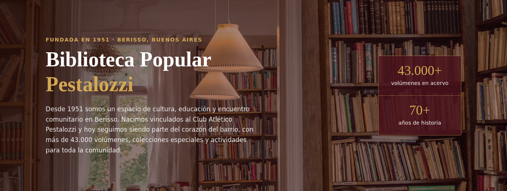

*Pantalla de inicio: nombre de la biblioteca, descripción y datos del acervo.*

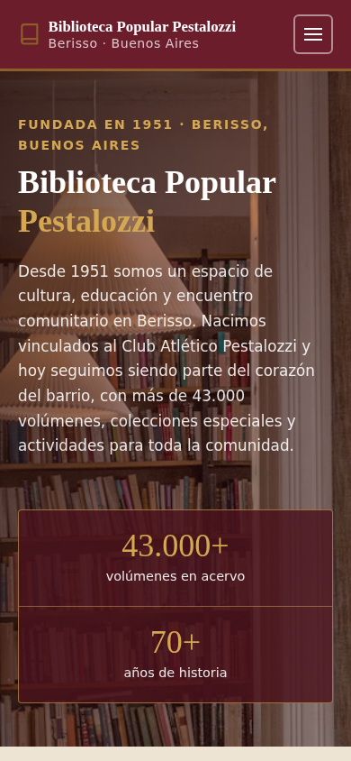

*La misma página en un teléfono: el contenido se reacomoda en una columna.*

---

## 4. La pantalla principal

La barra superior tiene el nombre de la biblioteca y el menú con cuatro accesos:

| Menú | Qué muestra |
|---|---|
| **Inicio** | Presentación, horarios, novedades y colecciones |
| **Colecciones** | Colecciones especiales y sala infantil |
| **Visitas Escolares** | Formulario para solicitar una visita |
| **Catálogos y Trámites** | Acceso a Koha, Greenstone y trámites de asociación |

En el teléfono, el menú se abre con el botón de tres líneas.

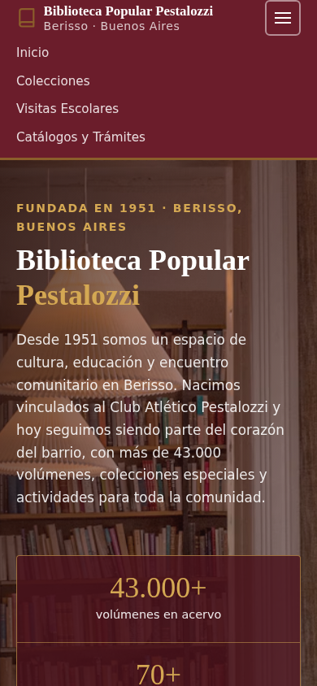

*El menú desplegado en un teléfono.*

---

## 5. Secciones del sitio

### 5.1 Horarios de atención

Muestra los siete días de la semana. Los días con atención aparecen destacados y los cerrados dicen **Cerrado**.

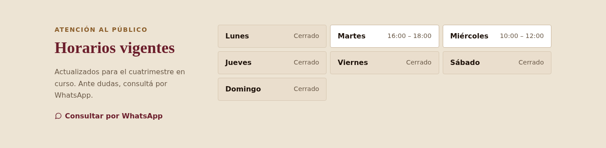

*Cartelera de horarios. Los horarios se actualizan desde el panel.*

> Si la biblioteca cambia un horario, el cambio se refleja en esta sección sin necesidad de tocar el sitio.

### 5.2 Novedades

Tres tarjetas con las novedades de la biblioteca: donaciones, recomendaciones e incorporaciones.

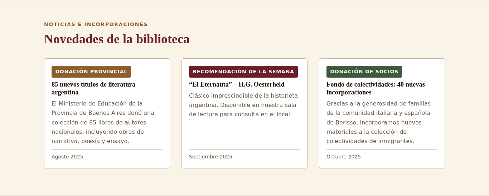

*Cada tarjeta tiene una etiqueta de color, una fecha y una descripción.*

### 5.3 Colecciones

Presenta las colecciones especiales, como el fondo Berisso–La Plata y la colección de colectividades de inmigrantes.

Debajo de las dos tarjetas aparece **Materiales destacados**, con los títulos cargados desde el panel para cada colección. Si un material tiene enlace al catálogo, se muestra el acceso.

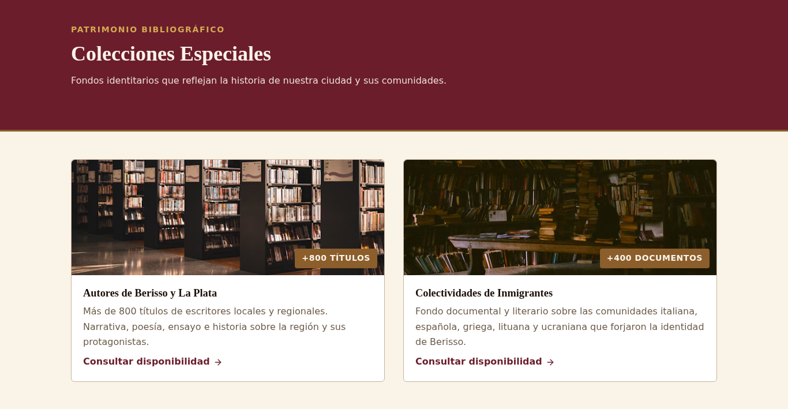

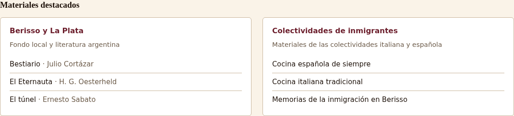

### 5.4 Sala infantil (bebeteca)

Cuatro propuestas de lectura para las infancias.

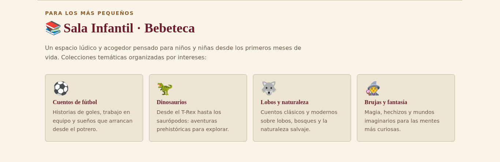

### 5.5 Catálogos externos

Permite acceder al catálogo Koha y al repositorio Greenstone de la biblioteca.

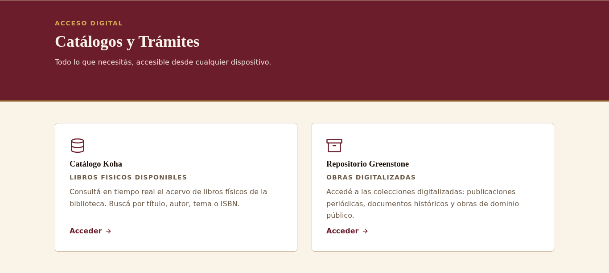

> Mientras la biblioteca no envíe las direcciones definitivas, al presionar **Acceder** aparece un aviso de que el enlace estará disponible próximamente.

### 5.6 Asociación y préstamos

Explica cómo asociarse y cómo pedir o renovar un préstamo, con los datos del trámite.

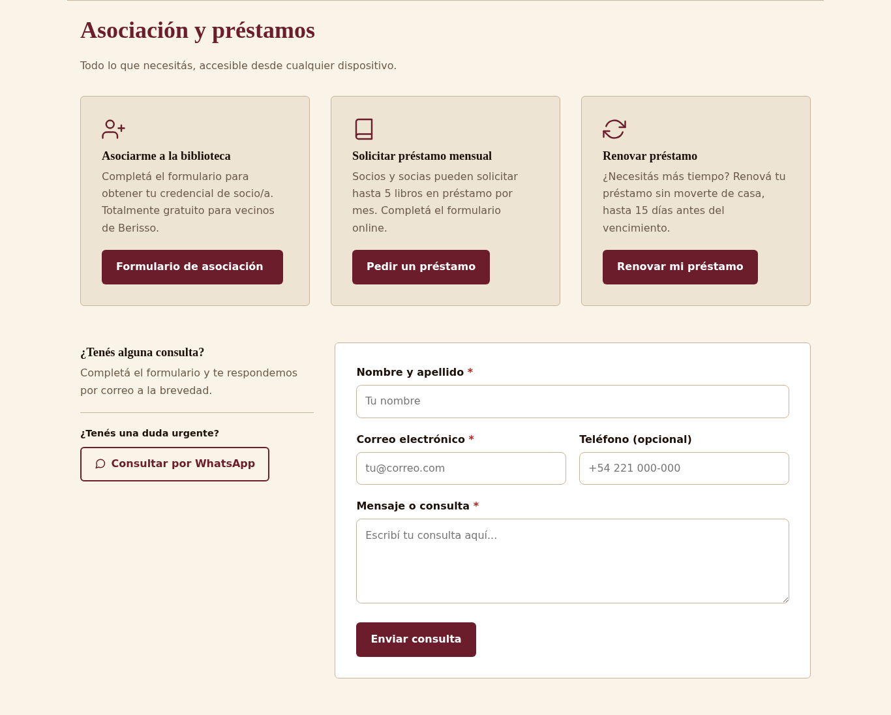

> Igual que en los catálogos, los destinos definitivos están pendientes de confirmación por parte de la biblioteca.

### 5.7 Contacto y redes

Al pie de página están la dirección, el teléfono, el correo electrónico, las redes sociales y los accesos directos de WhatsApp.

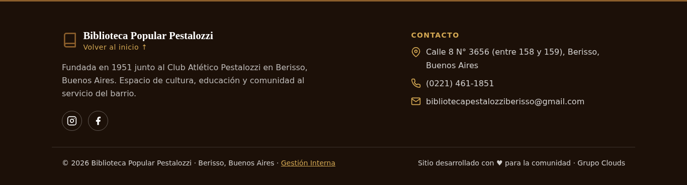

*La dirección abre el mapa y el teléfono permite llamar con un toque.*

---

## 6. Flujos de uso

### 6.1 Consultar los horarios

1. Abrir el sitio.
2. Desplazarse hasta **Horarios de atención** o tocar **Inicio** en el menú.
3. Leer el día y el rango horario. Los días abiertos están resaltados.

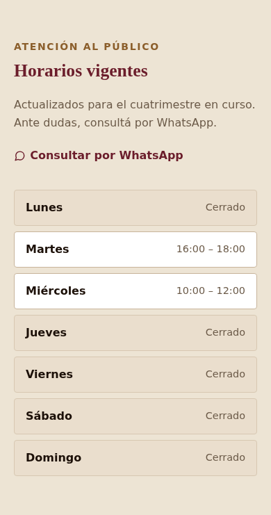

*La misma información en un teléfono.*

### 6.2 Pedir una visita escolar

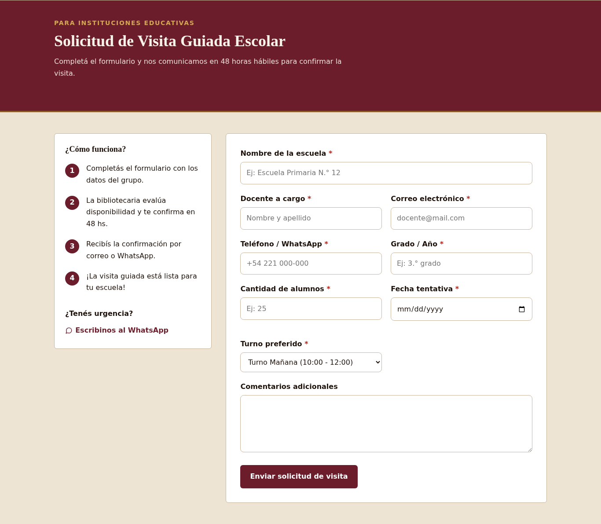

*La sección de visitas escolares: explicación del servicio y formulario.*

1. Tocar **Visitas Escolares** en el menú.
2. Completar el formulario:

| Campo | Obligatorio | Ejemplo |
|---|---|---|
| Institución | Sí | Escuela Primaria N.° 12 |
| Docente responsable | Sí | Mariana Gómez |
| Correo electrónico | Sí | docente@escuela12.edu.ar |
| Teléfono | Sí | 221 455-6677 |
| Nivel o grado | Sí | 4.° grado |
| Cantidad de alumnos | Sí | 28 |
| Fecha preferida | Sí | 15/11/2026 |
| Turno | Sí | Mañana |
| Comentarios | No | Interés en la colección de colectividades |

3. Presionar **Enviar solicitud de visita**.
4. Esperar el mensaje de confirmación: *"Solicitud enviada con éxito. La bibliotecaria te confirmará disponibilidad."*

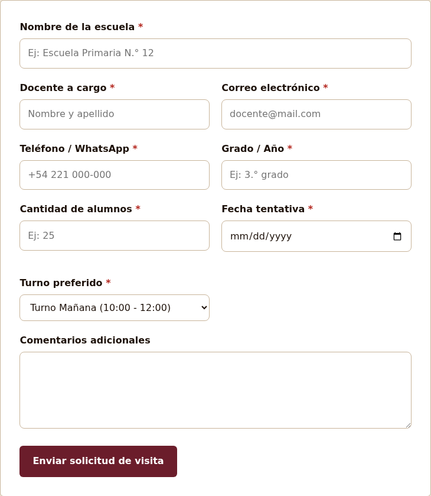

*El formulario completo. Los campos obligatorios están marcados con asterisco.*

Si falta un dato o el correo no tiene formato válido, el campo se marca en rojo y aparece un mensaje debajo. No se envía nada hasta corregirlo.

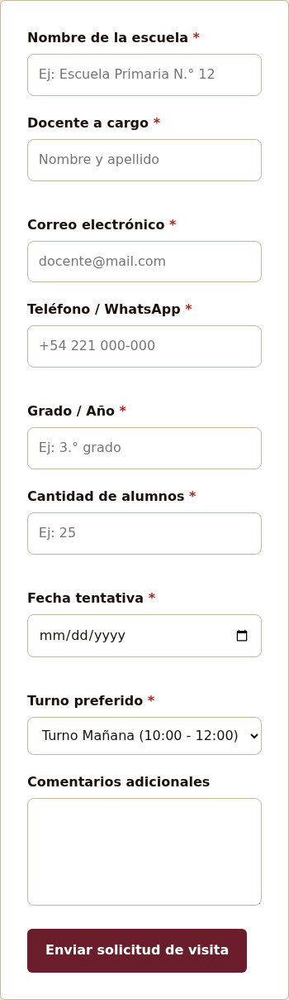

*El mismo formulario en un teléfono: los campos se apilan en una columna.*

### 6.3 Enviar una consulta general

1. Ir a la sección **Asociación y préstamos**, bloque **¿Tenés alguna consulta?**.
2. Completar nombre, correo, teléfono (opcional) y mensaje.
3. Presionar **Enviar consulta**.
4. Esperar la confirmación: *"Consulta enviada con éxito. Te responderemos a la brevedad."*

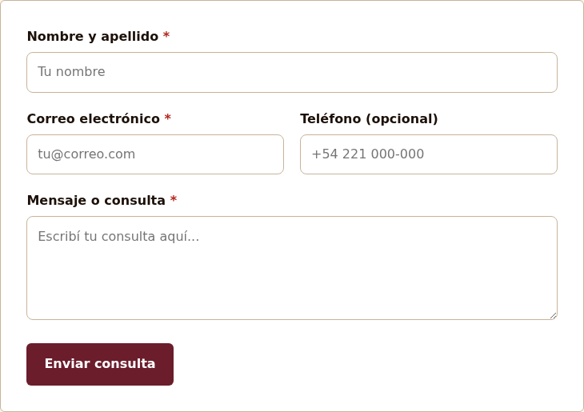

### 6.4 Contactar por WhatsApp

1. Tocar cualquier botón de **WhatsApp** (en horarios, en visitas o en el pie).
2. Se abre la aplicación con un mensaje ya escrito.
3. Enviarlo.

### 6.5 Ingresar al panel de administración

1. Abrir **https://biblioteca-pestalozzi-production.up.railway.app/admin.html**.
2. Escribir el usuario y la contraseña.
3. Presionar **Ingresar al Panel**.

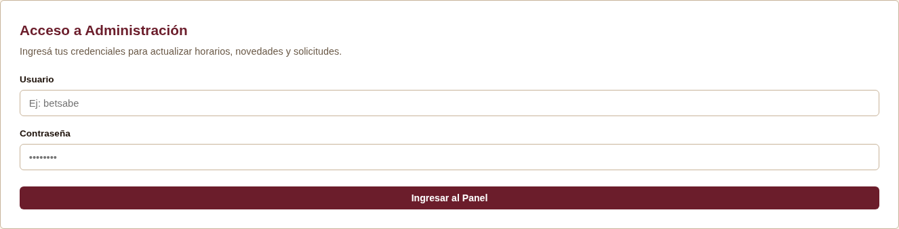

> Si la contraseña es incorrecta, el sistema muestra *"Credenciales inválidas"* y no permite el ingreso.

---

## 7. El panel de administración

Al ingresar aparecen tres pestañas y el botón de notas.

| Pestaña | Para qué sirve |
|---|---|
| **Horarios Cuatrimestrales** | Actualizar los días y horarios de atención |
| **Visitas Escolares** | Ver y gestionar las solicitudes recibidas |
| **Novedades de la Biblioteca** | Publicar, editar, eliminar y reordenar novedades |
| **Consultas** | Leer y eliminar las consultas del formulario general |
| **Catálogo** | Administrar las categorías de colección y sus materiales |
| **Notas** | Bloc personal de la bibliotecaria |

### 7.1 Actualizar los horarios

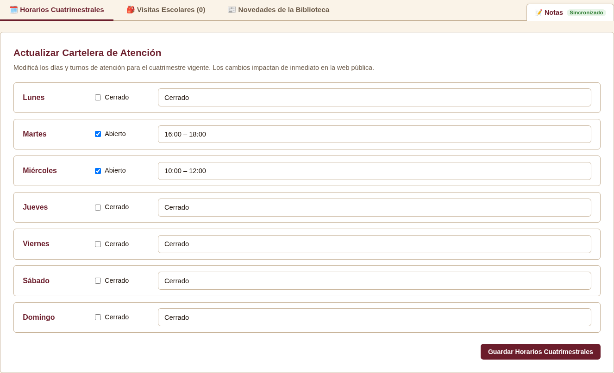

1. En cada día, marcar **Abierto** o **Cerrado**.
2. Si el día está abierto, escribir el rango en el campo de texto, por ejemplo `16:00 – 18:00`.
3. Presionar **Guardar Horarios Cuatrimestrales**.
4. Esperar el mensaje: *"Cartelera de horarios guardada exitosamente."*

El cambio se ve de inmediato en el sitio público, sin necesidad de avisar a nadie ni de volver a publicar.

> Si un día queda como **Cerrado**, el sitio lo muestra con la palabra "Cerrado" y no lo oculta.

### 7.2 Gestionar las solicitudes de visita

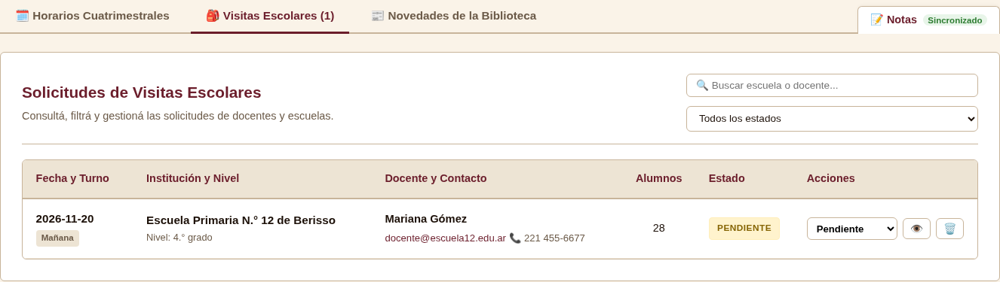

1. Abrir la pestaña **Visitas Escolares**.
2. Revisar los datos de cada solicitud: institución, docente, contacto, fecha y cantidad de alumnos.
3. Cambiar el estado a **Confirmada** cuando esté acordada.
4. Eliminar la solicitud si corresponde, confirmando la acción en el cuadro de diálogo.

### 7.3 Publicar novedades

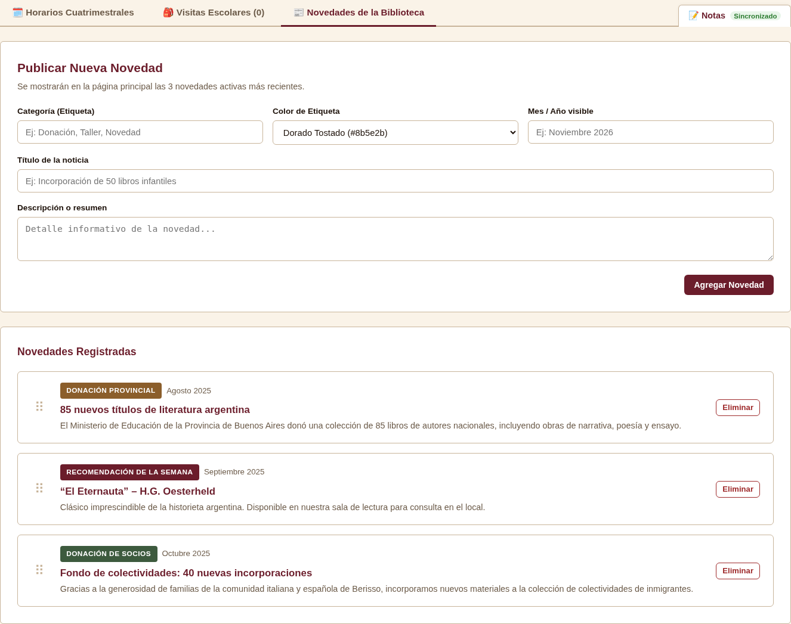

1. Abrir la pestaña **Novedades de la Biblioteca**.
2. Completar categoría, título y descripción.
3. Si la novedad se relaciona con un día de atención, elegirlo en **Día relacionado** (es opcional).
4. Presionar **Publicar novedad**.
5. Para cambiar el orden, arrastrar las tarjetas.
6. Para editar o eliminar, usar los botones de cada tarjeta. La eliminación pide confirmación.

La novedad aparece en el sitio público en cuanto se publica.

### 7.4 Usar el bloc de notas

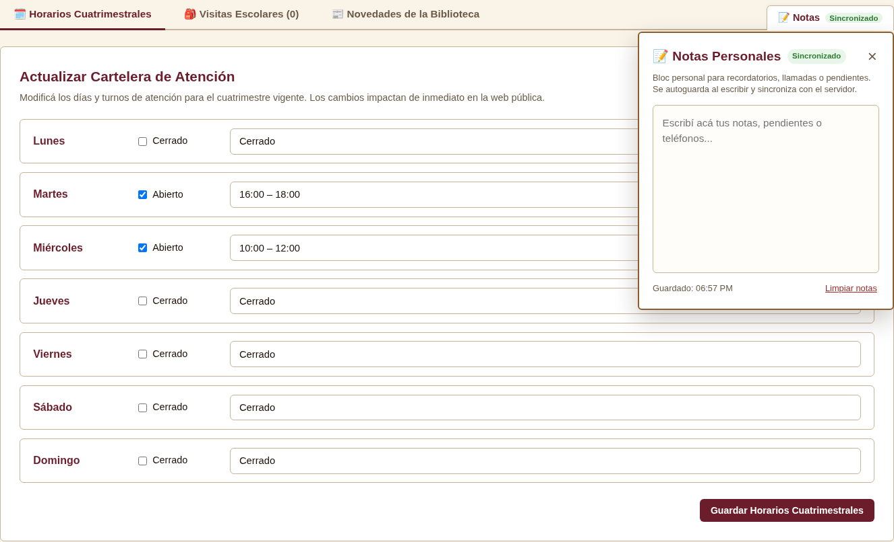

1. Presionar el botón **Notas** en la esquina superior derecha.
2. Escribir el texto.
3. El bloc guarda solo y muestra **Sincronizado** cuando terminó.

Las notas son privadas: no se publican en el sitio.

### 7.5 Leer y eliminar consultas

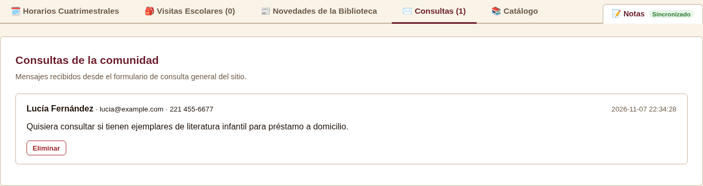

1. Abrir la pestaña **Consultas**. El número entre paréntesis indica cuántas hay.
2. Leer el nombre, el contacto y el mensaje de cada consulta.
3. Presionar **Eliminar** y confirmar cuando la consulta ya fue respondida.

Las consultas también se envían al correo de la biblioteca; el panel conserva el historial.

### 7.6 Administrar el catálogo de colecciones

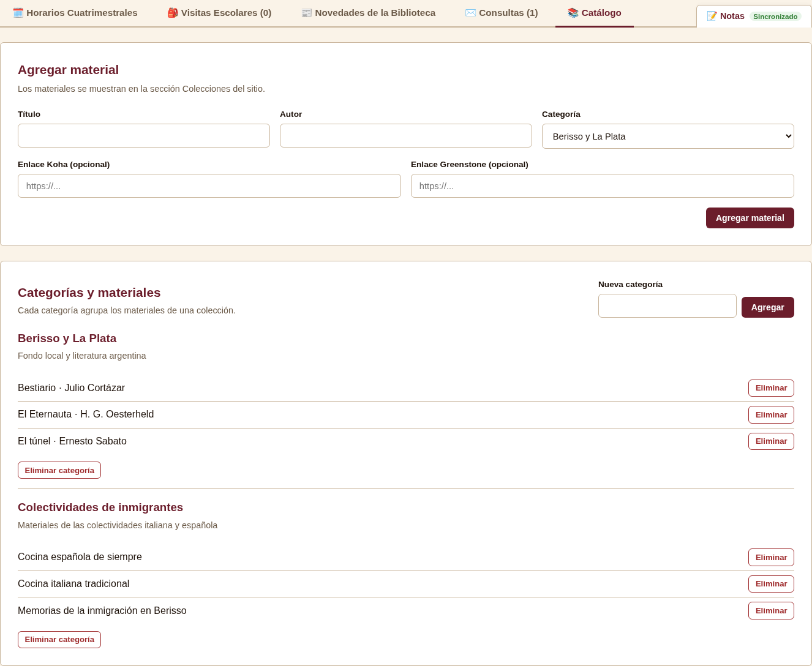

1. Abrir la pestaña **Catálogo**.
2. Para agregar un material, completar título, autor (opcional), categoría y, si existe, el enlace al catálogo Koha o Greenstone.
3. Presionar **Agregar material**.
4. Para crear una categoría nueva, escribir el nombre en **Nueva categoría** y presionar **Agregar**.
5. Para borrar un material, usar **Eliminar** y confirmar.
6. Una categoría solo se puede eliminar cuando ya no tiene materiales.

Los materiales aparecen en la sección **Colecciones** del sitio público.

---

## 8. Mensajes y alertas frecuentes

| Mensaje | Cuándo aparece | Qué hacer |
|---|---|---|
| *"Revisá los campos marcados antes de enviar."* | Falta un dato obligatorio o el correo no es válido | Completar o corregir el campo marcado en rojo |
| *"Solicitud enviada con éxito…"* | La visita se registró | Esperar el contacto de la biblioteca |
| *"No se pudo enviar la solicitud…"* | Falló la conexión | Reintentar o usar WhatsApp o correo |
| *"Consulta enviada con éxito…"* | La consulta se envió | Esperar la respuesta |
| *"Ocurrió un error al enviar la consulta…"* | Falló el envío | Reintentar o escribir por WhatsApp |
| *"Credenciales inválidas"* | Usuario o contraseña incorrectos | Revisar los datos e intentar de nuevo |
| *"Acceso denegado: el token ha expirado…"* | La sesión venció | Volver a iniciar sesión |
| *"Cartelera de horarios guardada exitosamente."* | Se guardaron los horarios | Nada, el cambio ya está publicado |
| *"Novedad eliminada."* | Se borró una novedad | Nada |
| *"El catálogo estará disponible próximamente…"* | El enlace externo aún no está cargado | Esperar la confirmación de la biblioteca |
| *"Consulta eliminada."* | Se borró una consulta del panel | Nada |
| *"Material agregado correctamente."* | Se sumó un material al catálogo | Nada |
| *"No se puede eliminar la categoría porque tiene materiales asociados."* | La categoría todavía tiene materiales | Borrar primero los materiales |

---

## 9. Preguntas frecuentes

**No veo un cambio que hice en el panel.**
Esperar unos segundos y recargar la página. Si el cambio no aparece, verificar que se haya presionado el botón de guardar y que el mensaje de confirmación haya aparecido.

**Olvidé la contraseña del panel.**
La contraseña se cambia desde el mismo panel una vez adentro. Si no se puede ingresar, debe restaurarla la persona responsable del sistema.

**El sitio dice "Cerrado" en un día que debería estar abierto.**
Entrar al panel, marcar el día como **Abierto**, escribir el horario y guardar.

**Puedo usar el sitio desde el teléfono.**
Sí. El sitio se adapta a cualquier pantalla y los formularios se apilan en una columna.

**Necesito enviar una foto o un archivo.**
Los formularios del sitio no admiten archivos. Para enviar documentación, usar el correo institucional o WhatsApp.

---

## 10. Soporte

| Canal | Datos |
|---|---|
| Dirección | Calle 8 N.° 3656 (entre 158 y 159), Berisso |
| Teléfono | (0221) 461-1851 |
| Correo | bibliotecapestalozzi.berisso@gmail.com |
| WhatsApp | Desde los botones del sitio |
| Instagram | @bibliopestalozzi |

Para consultas sobre el funcionamiento del sitio, contactar al equipo de desarrollo del proyecto.
